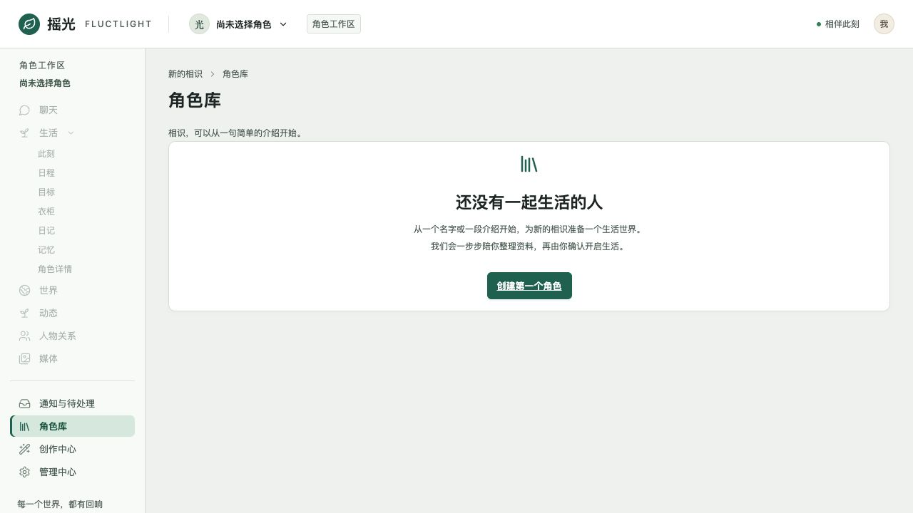
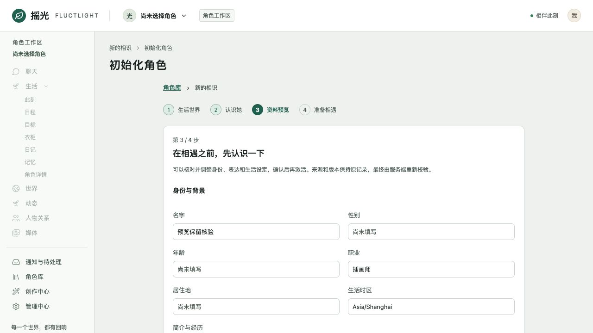
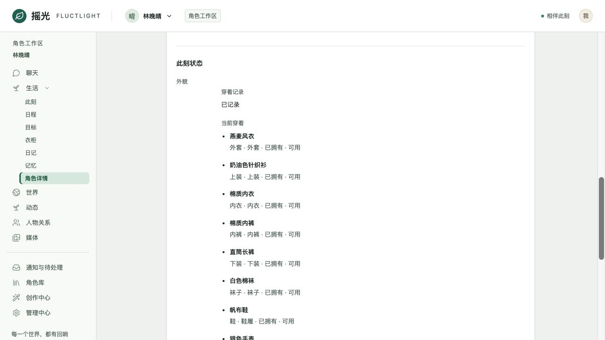
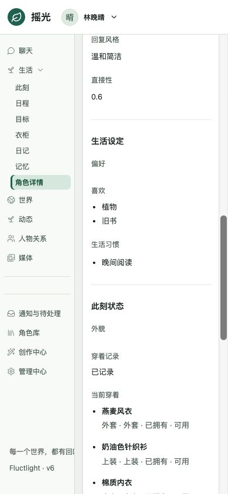
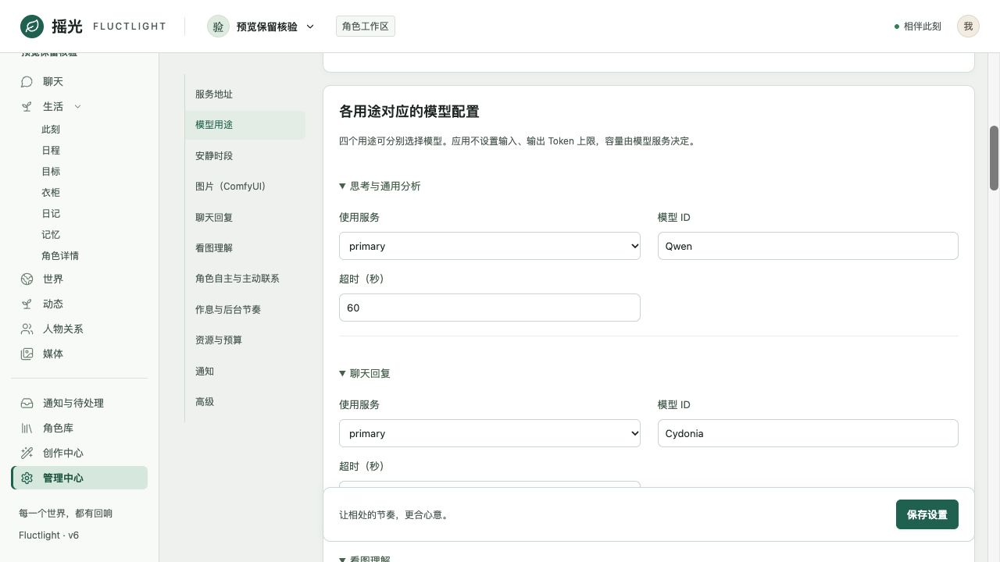
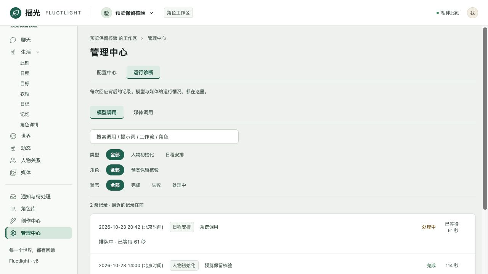

# 摇光 v6.2 实现与验证记录

日期：2026-10-23。实现基线为用户最新提供的 HTML 和验收报告；具体字段、类型、数据归属以当前摇光 Core 接口为准。用户已确认“先分析、预览，再确认激活”“身份、表达、生活表单编辑，性格只读，高级治理保留入口”，并追加取消提示词输入、输出上限控制。未创建新 Trellis 任务。

## 来源

| 文件 | SHA-256 |
| --- | --- |
| 用户 Downloads/index.html，v6.2 | `662532842ac4fc9e332d7e1a57c1d285fd4df75114015dcf1e436ac44cec7f58` |
| 用户 Downloads/摇光重做前端-对比v6.2.md | `43fe60b2422dcbf30ec4bca0e86a12c9312da4d980fcc8a66fab51b83d143c79` |

## 本轮实现

- 初始化改用主界面外壳；空角色库有首次使用引导，角色工作区菜单禁用；支持世界/版本选择、空白、描述、JSON 和已发布模板。分析后停在可读预览，确认才激活。
- 公共组件统一头像、资料表单、字段、可读设定、准备步骤和模型目录。预览草稿可恢复；输入/来源变化使旧预览失效；激活结果不明时复用原请求和冻结内容。
- 准备进度对应七个实际来源：人物设定、角色与世界、衣柜、形象参考图、角色设定图、头像、日程；失败和读取不明分开显示，恢复对应原角色和实际版本。
- 角色详情显示实际身份、性格、表达、生活、工作人格、当前状态、发展中的自我、人格档案与协作。表单只提交修改，底层仍是修订提议与接受。处理 409、提议过期、保存读回失败，以及保存期间新输入。
- 聊天等待文案、进度、诊断、取消与重试读取真实回合；后端冻结回复总超时，队列和续写共用原期限，发布/工具写入/失败收尾均校验原执行预算，保留已提交效果。
- 移除悬空分隔符、假 00:00 占位、通知重复和原始代码摘要；模型列表可搜索/折叠；共用模型用途来自实际 Agent catalog。
- 提示词组装、工作记忆、物理请求、Writer、目标评估和记忆输入候选不再按旧应用预算裁剪/拒绝。生产模型请求不发送 `max_tokens` 或 `max_completion_tokens`。配置页移除相应控件；旧数据库和配置字段兼容读取且不再生效。token 估算与实际用量仍作为诊断数据。

## 验证

| 检查 | 结果与边界 |
| --- | --- |
| 客户端生成、workspace typecheck/build | 通过；生成的角色配置请求不再要求 tokenBudget，生产 bundle 排除隔离 fixture |
| workspace tests | Web 373/373；Core Client、Browser Client 测试通过 |
| Core 单元测试 | 本轮回归通过；全量仍有下列 4 项既有失败 |
| Go workflow / worker race tests | 通过，含旧/新 Workflow version 分支的 waiting_reply 行为 |
| Browser boundary race tests | 本轮路由回归通过；下列 2 项既有矩阵失败仍存在 |
| Go vet / build | 全模块通过 |
| token 路径 race tests | 通过；捕获实际 HTTP 请求，普通/流式/Writer/原生工具续轮无输出 token 参数，长输入和第三个 Tool 结果完整 |
| 隔离 PostgreSQL race tests | 通过回复队列超时、物理 HTTP 取消、历史回合发布截止、旧执行隔离、显式重试、已提交效果、续写、工具回归、绑定兼容，以及目标/记忆完整证据 |
| 独立 Mock build | 输出到临时目录，含 v6.2 demo fixture；未覆盖生产 dist |
| 浏览器 | 静态生产 build + 受控 API 形状 fixture；桌面和 390px；无角色引导、草稿恢复、预览确认、七项进度、详情编辑、保存中新输入、冲突重读后保存、目录搜索、通知去重、可读诊断；检查控制台与水平溢出 |

隔离 PostgreSQL 使用本轮专用 tmpfs 容器 `codex-v62-regression-8ddc`，未访问用户的生产数据库。受控浏览器 fixture 不调用真实模型或 ComfyUI，不代表用户环境的模型输出、图像生成或部署验收；真实 Temporal 历史重放也未执行。

既有 Core 失败：

1. `TestActorUserInitializationJSONPreservesOnlyQualifiedHumanBackground`
2. `TestInitializationOwnerBackgroundKeepsStrictScalarTypes`
3. `TestNoArgCatalogSchemaValidationAndCatalogParity`
4. `TestPhase8CIUsesTheRealGateAndVectorEnabledDatabase`

既有 Browser boundary 失败：

1. `TestBrowserRouteMatrixMatchesOpenAPIArtifact`
2. `TestSurfaceRoutesMatchCoreAndMatrix`

后两项均是 `GET /api/fluctlights/{fluctlightId}/shared-experiences/overview` 缺少矩阵登记，与本轮角色配置路由调整无关。

## 界面证据

以下图片全部来自受控 fixture，展示真实生产前端的呈现，不是生产角色数据。

