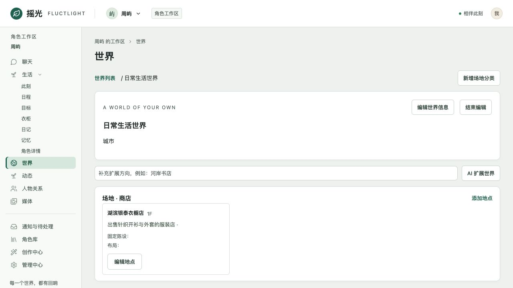

# v6.2 R8 修复与验收边界

反馈来源：用户提供的 R8 走查报告和脱敏诊断。本轮沿用隔离分支，不创建任务，
不修改原工作区或用户业务数据库。报告中的数据库操作描述仅作证据。

## 本轮改动

| 问题 | 已落地处理 | 验证范围 |
| --- | --- | --- |
| 场地刷新消失 | 新增场地分类改为真实世界 CAS 写入 venue_categories，再读回；分类与具体地点明确区分 | 实际 World 组件、浏览器边界、专用 PG、生产构建浏览器保存/刷新 |
| 编辑世界可能变成新建 | renderer 保留原 _source，提交原世界 ID 与 revision | 实际页面编辑回归 |
| 购物 items 是 JSON 字符串 | 按声明的 array/object 类型恢复同形合法容器，再严格校验；不改普通字符串/用户正文 | 畸形、错形、缺字段、权限信封负向回归 |
| 真实商品 ID 仍买不到 | 返回实际 required_place_id 或不匹配字段和期望值；明确单件/组合互斥和计时边界；目录说明购物发现能力 | 有绑定地点的真实目录商品，开始→结算→入库→独立换装 PG 闭环 |
| 初始日程等图片 | 串行顺序调整为人格→衣柜→日程→图片，原 schedule intent 在衣柜完成后释放 | 实际 dispatcher SQL、无图片/失败图片、保留人格与衣柜前置条件 |
| segment 自称其他模型、合同失败 | 真实参与者、author 别名和显示名进入分段任务；明确原生 JSON 合同/版本 | 物理请求与无工具修复回归；两个本机模型分段生成 |
| 询问旧动态却发布新动态 | 安装只读 moment.inspect；已发布原文和时间进入 Writer；completed 的发布回执保留正文 | 专用 PG 范围/分页/不写副作用、真实 Writer 输入、本机成功片段与失败尝试 |
| 无效目录往返 | 连续两次同样成功加载后收起目录；三次相同加载/结果则停止下一次物理调用 | 单元、实际本机目录空转终止 |
| 男性补充设定与“她” | 不适用字段及男性未知胸部字段不展示；保留显式有值数据；修正新旧资料入口与失败/等待文案 | 实际组件及桌面/390px 浏览器 |

## 为什么以前的修复没有覆盖这些问题

1. 把真实具体地点保存与前端分类草稿当成同一路径。具体地点原有 SQL 能保存，
   “新增场地”却只执行本地数组 push；世界保存也不提交该草稿。本轮闭环到独立
   的分类字段，并核对浏览器 allowlist、OpenAPI、生成客户端和 Core 写入。
2. 只看商品 category，漏掉 catalogue 的稳定 place_id 约束；错误统一成
   shopping_catalogue_invalid 后，模型无法知道应该纠正哪个字段。本轮保留
   地点/来源权威，返回可执行的精确反馈，未按地名猜 ID。
3. 累计摘要已有 author 别名，segment 独立入口却没有；只检查共享模型角色无法
   覆盖任务变体。当前按原始 author_actor_id 标记参与者，不改聊天文本。
4. R7 只桥接动作状态，Moment 正文被 allowlist 删除，且没有动态只读工具。
   新增工具与专用 Writer 事实通道，未开放任意 query 或草稿正文。
5. “从 native tools 收起目录”只是对模型的物理可见性约束；本机模型实际会继续
   调用已不在列表中的工具。服务端必须根据真实重复结果终止空转，不能只补提示。

这些契约已记录到 `.trellis/spec/backend/r8-recovery-contract.md`，并更新能力目录
清单与模型输入清单；本仓库没有对应 `src/templates` 镜像。

## 自动化与浏览器验证

- Web 404 项与客户端 43 项通过；全工作区 typecheck 通过。
- Go vet/build 通过；最终 R8、相关 R7 事实桥、购物/世界、创建顺序和浏览器
  边界的专用 PG/race 回归通过。
- Go 全量仍有原有六项基线失败：ActorUser 初始化 JSON、初始化严格标量、
  无参 catalog parity、Phase8 CI 旧门禁、Browser route matrix、Surface matrix。
  新增能力引起的目录、显式清单和数量检查已同步，未归入基线掩盖。
- 生产构建在隔离 HTTP 夹具中验证分类保存/刷新、具体地点保存、男性详情、
  390px 布局，浏览器 error 日志为空。该浏览器夹具不替代上面的真实 PG 验证。
- 购物 PG 正向用受控结果 Provider 验证数据库链路；只有活动到期后的结果提交
  才产生 purchase_result，随后独立穿戴，保留原衬衫与项链。这不等于真实模型
  自主完成购物已通过。

## 本机真实模型：完整自主聊天验收未通过

使用本机 MLX 的 Qwen3.8 27B 与 Cydonia 24B，所有模型请求串行，无应用输入/
输出 token 上限。原始合成 wire 留在 `/private/tmp/r8-live-*`，提交的安全摘要见
[local-model-results.json](evidence/v62-r8/local-model-results.json)。

- 分段 JSON 能生成并区分用户与苏晚；原文未被修改。
- Qwen 有一次实际走 catalog→moment.inspect→conversation.reply，返回已存动态
  原文“今天在书店读完了那本湖边散步随笔。”，动态总数未增加。该次测试最初
  错把纯查询当作 mutation-ledger 行检查，已纠正为核对原生 ToolResult。
- 后续 Qwen 重复目录请求，服务端以 tool_discovery_no_progress 结束；这是
  有界失败，不是自然查询质量通过。
- Qwen 自主购物读取了真实目录，但之后 scene_event 因 logical_agent_lease_lost
  未完成，未获得完整购物/入库/换装成功证据。没有放宽租约、地点或来源校验。
- Cydonia 发生 conversation_native_output_missing，另一次只追问店铺信息，
  没有开始购物。完善购物目录描述后复测仍没有通过原生输出合同。

因此本轮不能标记“聊天买衣、动态回忆和整体响应速度全部通过”。已经修复
可确证的参数/发现/事实桥缺口；部署实际模型的自主选择、长等待与连续性仍需
优先复测。保留 opt-in live 正向断言，不把模型拒绝/没有执行改判成功。

## 约定与已有错误聊天

R8 的西湖约定实际回复为追问，没有接受，不属于已接受却漏落日程的确证。
本轮不强制接受、不伪造承诺或日程。报告中的“我是 Claude”等历史回复仍保留
为历史陈述；没有记忆条目时，遗忘记忆不会删除聊天。未擅自删除用户历史。
新分段身份归属和现状权威修复不构成旧长对话的全部语义验收。
